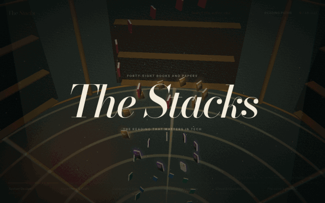
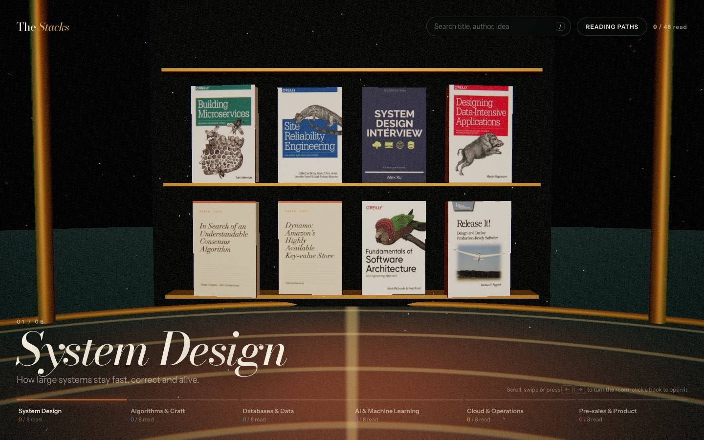
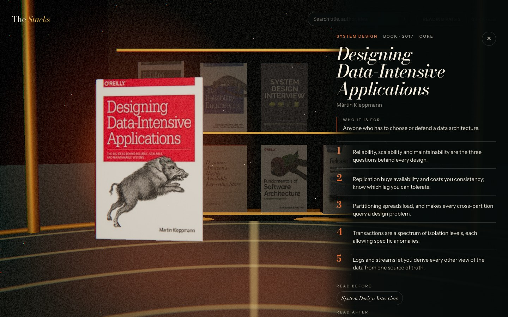
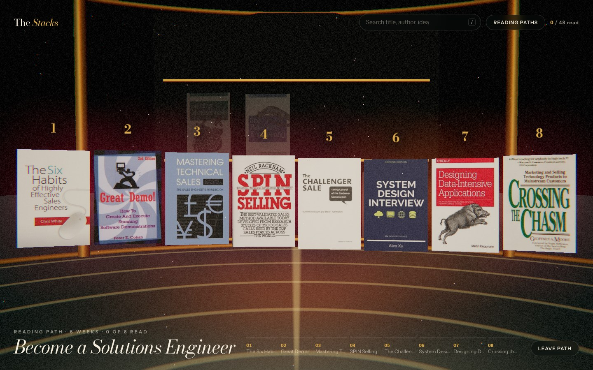
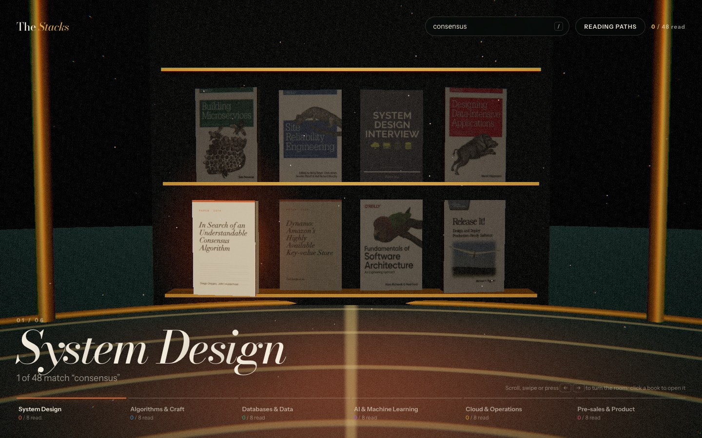
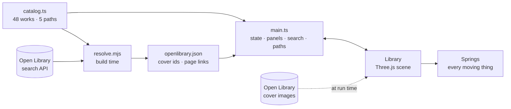

<div align="center">

# The Stacks

**A 3D library of the books and papers that matter in tech.**

Walk a circular reading room. Each wall is a field. Open a book for its five key ideas,
follow a reading path, and keep track of what you have read.

### [▶ Open the live demo](https://egberr.github.io/the-stacks/)

No account. No API key. Nothing to install.



</div>

---

## What is inside

**48 works across six fields**, each chosen because people in the industry keep coming back to it.

| Field | Examples |
| --- | --- |
| **System Design** | Designing Data-Intensive Applications · Site Reliability Engineering · the Dynamo and Raft papers |
| **Algorithms & Craft** | Introduction to Algorithms · The Pragmatic Programmer · A Philosophy of Software Design |
| **Databases & Data** | Database Internals · Streaming Systems · the GFS, MapReduce and Bigtable papers |
| **AI & Machine Learning** | Deep Learning · Designing Machine Learning Systems · Attention Is All You Need |
| **Cloud & Operations** | Accelerate · Team Topologies · Operating Systems: Three Easy Pieces |
| **Pre-sales & Product** | Mastering Technical Sales · Great Demo! · SPIN Selling · Crossing the Chasm |

For every work you get:

- **who it is for**, in one line;
- **five ideas worth keeping**;
- **what to read before and after**, as links that walk you across the room;
- a link to its **Open Library** page, and to a **legal free edition** when the author or publisher offers one (12 of the 48).

| | |
| --- | --- |
|  |  |
|  |  |

## Reading paths

Pick a goal and the books leave their shelves, cross the room and line up in reading order.

| Path | Reads | Suggested pace |
| --- | --- | --- |
| System design interview | 6 | 4 weeks |
| Become a Solutions Engineer | 8 | 6 weeks |
| Coding interview | 5 | 5 weeks |
| Zero to AI engineer | 6 | 8 weeks |
| Data engineering foundations | 7 | 6 weeks |

## Using it

| To | Do |
| --- | --- |
| Turn the room | Scroll, swipe, press `←` `→`, or click a field at the bottom |
| Open a book | Click it. `←` `→` then moves along the shelf |
| Mark as read | The button in the book's notes, or `R` |
| Search | Press `/` and type a title, an author or an idea |
| Close | `Esc` |

Books you mark as read keep a brass bookmark and a soft glow. That list is stored in your own browser (`localStorage`) and nowhere else. Link straight to a book with `?book=ddia`, or to a path with `?path=solutions-engineer`.

## About the summaries

**Every summary here is original, written for this project.** Nothing is quoted or paraphrased passage by passage from the works, and no book content is reproduced. The aim is to help you decide what to read next, not to replace the reading.

They are one reader's distillation, so they are opinionated and incomplete by nature. If you think an idea is missing or wrong, open an issue.

## Where the data comes from

- **The collection and the summaries** live in one file, [`src/data/catalog.ts`](src/data/catalog.ts).
- **Covers and book pages** come from [Open Library](https://openlibrary.org/), a free service of the Internet Archive. A build script looks each title up once and stores the result in [`src/data/openlibrary.json`](src/data/openlibrary.json), so the site makes no API calls at all: it only loads cover images.
- **38 of the 42 books** have artwork on Open Library. The other four, and all six papers, get a typographic cover drawn in code. Every book starts with a drawn cover and swaps to the artwork when it arrives, so nothing is ever blank.
- **Free-edition links** are checked by the same script and left out if they stop answering.

## How it is built



**Motion.** Nothing in the room is keyframed. Every moving thing, from a book to the camera's field of view, is a damped spring chasing a target ([`src/scene/motion.ts`](src/scene/motion.ts)). Springs can be retargeted mid-flight without a jump, so you can change wall while a book is still opening and the motion stays continuous.

**The books.** Each one is a small assembly: a block of pages, and a cover board on a hinge. On the shelf it faces the room. Picked up, it flies to the reader, makes one full turn, and its cover swings ajar. On a path, it takes its numbered place in a line fitted to the width of the screen.

**The room.** A rotunda of six bays, brass shelves and columns, an inlaid floor drawn by a shader that pools the colour of the open field, a shaft of light from the oculus and drifting dust. Bloom, lens fringing, vignette and grain are applied in post-processing.

**The type.** Titles are set letter by letter: each letter is its own element with a staggered entrance, and the outgoing word leaves before the new one arrives.

## Run it locally

Requires Node 20 or newer.

```bash
git clone https://github.com/EGberr/the-stacks.git
```

```bash
cd the-stacks && npm install
```

```bash
npm run dev
```

`npm run build` type-checks and writes a static site to `dist/`.

### Add or change a book

Edit [`src/data/catalog.ts`](src/data/catalog.ts), then refresh the Open Library data (Node 23.6 or newer):

```bash
npm run catalog
```

Each field holds eight works: two shelves of four.

## Project structure

```
src/
  main.ts              state, book notes, paths, search, reading marks
  data/
    catalog.ts         fields, works, summaries, reading paths
    openlibrary.json   generated: cover ids and page links
  scene/
    library.ts         the room, the books, the camera, input
    covers.ts          drawn covers and Open Library artwork
    motion.ts          springs and easings
scripts/resolve.mjs    looks every work up on Open Library
```

## Accessibility and devices

- Works with mouse, touch and keyboard.
- Honours `prefers-reduced-motion`: the opening flight is skipped and camera sway is off.
- Laid out for phones: the book's notes become a bottom sheet.
- Needs WebGL. Tested in Chrome.

## Tech

[Three.js](https://threejs.org/) · TypeScript · Vite · GLSL. One runtime dependency.

## Credits

Cover images and catalogue data: [Open Library](https://openlibrary.org/) (Internet Archive). Book covers are the property of their publishers and are shown to identify the works. Fonts: Bodoni Moda and Instrument Sans.

## License

Code: [MIT](LICENSE). The summaries in `catalog.ts` are released under the same licence.
